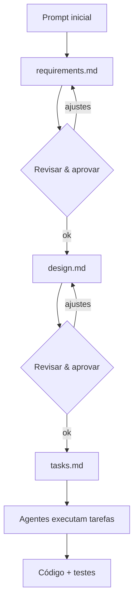

  

    <KiroMark size="88" />
  

  

    <KiroWordmark :width="320" />
  

  
Agentic IDE — da spec à produção

  
Treinamento interno · Spec-Driven Development

  Pressione <kbd>Espaço</kbd> para avançar <carbon:arrow-right class="inline" />

<!--
Capa. Apresente o Kiro em uma frase: um IDE agentic que transforma prompts em
specs, designs e tarefas, e as executa com agentes. Hoje: instalar, autenticar,
conhecer as ferramentas e colocar a mão na massa com SDD.
-->

---
layout: center
---

<!-- ===== DEV 1 ===== -->

Arthur Tristão

Cargo

Software Engineer Intern

Time

Club Setup

<!-- ===== DEV 2 ===== -->

Saymon Silva

Cargo

Staff Engineer I

Time

DACP

---
layout: center
class: text-center
---

# O que vamos ver hoje

  

    1
    

      
Instalação do Kiro

      
Solicitar acesso, verificar e instalar

    

  

  

    2
    

      
Autenticação & Setup inicial

      
Login via AWS IAM Identity Center

    

  

  

    3
    

      
Ferramentas

      
Steering, Skills, MCPs e mais — ao vivo

    

  

  

    4
    

      
Hands On — SDD

      
Spec-Driven Development na prática

    

  

<!--
Agenda. Partes 1 e 2 são guiadas; a 3 é mais demonstração ao vivo; a 4 é
mão na massa com todos acompanhando.
-->

---
layout: center
class: text-center
---

  PARTE 1
  
<KiroMark size="56" />

# Instalação do Kiro

Solicitação de acesso, verificação e instalação

<a
  href="https://hotmart.atlassian.net/wiki/spaces/platform/pages/2509799555/Configura+o+do+KIRO"
  target="_blank"
  class="kiro-chip inline-flex items-center gap-2 hover:opacity-80 transition no-underline"
>
  <carbon:launch /> Configurando o KIRO
</a>
<SkipButton :to="15" label="⏭ Pular Tutorial" />

<!--
Esta parte segue o fluxo oficial da Hotmart: o acesso ao Kiro é concedido via
AWS (perfil Amazon-Kiro-Pro-Plus na conta buildstaging), então antes de instalar
é preciso solicitar e aguardar a liberação do acesso.
-->

---

# Passo 1 — Solicitar acesso ao KIRO

O acesso ao Kiro é solicitado pelo **IT Service Desk**.

  
🔗 Link para solicitação

  

    <a href="https://hotmart.atlassian.net/servicedesk/customer/portal/4/group/345/create/3641">IT Service Desk — Concessão de Acesso</a>
  

  
Como preencher o chamado

  <ul class="text-sm kiro-dim leading-relaxed">
    <li><b>Sistema:</b> AWS - Kiro</li>
    <li><b>Perfil / Banco:</b> <code>AWS_hotmart_Kiro_Pro</code></li>
    <li><b>Resumo:</b> Solicitar acesso para o AWS - Kiro</li>
  </ul>

<!--
Ao vivo (opcional): abra o formulário e mostre o preenchimento. Reforce o perfil
exato AWS_hotmart_Kiro_Pro — é o que libera o Kiro.
-->

---

# Passo 2 — Verificar a concessão de acesso

Após a aprovação do ticket, em algumas horas o acesso é concedido na sua **conta AWS**.

Acesse o **AWS Access Portal** por uma das opções:

  
OKTA <a href="https://hotmart.okta.com/app/UserHome" class="text-sm">hotmart.okta.com/app/UserHome</a>

  
AWS Direto <a href="https://d-90671335e2.awsapps.com/start/#/" class="text-sm">d-90671335e2.awsapps.com/start</a>

  Verifique se o perfil <b class="kiro-accent">Amazon-Kiro-Pro-Plus</b> está disponível na conta <b class="kiro-accent">buildstaging</b>.

<!--
Ao vivo: mostre o portal. Se o perfil não aparecer, ainda não liberou — pode
levar horas (ver slide de erro no fim).
-->

---

# Passo 3 — Instalar o KIRO IDE e CLI

Instale o **KIRO IDE** para aproveitar melhor os recursos próprios da IDE.

  
🔗 Download

  <a href="https://kiro.dev/downloads/">kiro.dev/downloads</a>

O CLI é opcional, mas recomendado para fluxos de terminal e automações.

Após instalar, abra o app — a tela inicial traz o <b>Sign in</b>.

<!--
Ao vivo: mostre o site de download e a tela inicial do Kiro recém-instalado.
A autenticação é a Parte 2.
-->

---
layout: center
class: text-center
---

  PARTE 2
  
<KiroMark size="56" />

# Autenticação & Setup Inicial

Passo 4 — Adicionar o KIRO na IDE via AWS IAM Identity Center

<!--
A autenticação na Hotmart é feita pela organização (AWS IAM Identity Center),
não por Builder ID pessoal. O fluxo tem 6 etapas — vamos uma a uma.
-->

---

# O fluxo de login — visão geral

  
1
Clicar em <b>Sign in</b> na tela inicial

  
2
Escolher <b>Your organization</b>

  
3
<b>Sign in via IAM Identity Center instead</b>

  
4
Informar <b>Start URL</b> + <b>Region</b>

  
5
<b>Permitir acesso</b> na aba do navegador

  
6
Confirmar <b>Signed in with AWS IAM Identity Center</b>

Abra um novo link no browser para login durante o processo.

---

# Passos 1 e 2 — Sign in → Your organization

  1
  
Na tela inicial do Kiro, clique em <b>Sign in</b>.

  2
  
Em <i>Choose a way to sign in/sign up</i>, selecione <b class="kiro-accent">Your organization</b> (não Google, GitHub ou Builder ID).

  O login abre uma aba no navegador. Mantenha o Kiro aberto — ele volta a receber o foco ao final.

---

# Passos 3 e 4 — IAM Identity Center + Start URL

  3
  
Clique em <b class="kiro-accent">Sign in via IAM Identity Center instead</b>.

  4
  

    Preencha o <b>Start URL</b> e a <b>Region</b>:
    

      
<b>Start URL:</b> <code>https://hotmart.awsapps.com/start</code>

      
<b>Region:</b> <code>us-east-1</code>

    

  

---

# Passos 5 e 6 — Permitir acesso e confirmar

  5
  
Na aba aberta automaticamente, clique em <b class="kiro-accent">Permitir acesso</b>.

  6
  
A IDE já está configurada para uso.

  ✅ Para conferir, abra a <b>aba do perfil</b> e confirme a mensagem <b class="kiro-accent">“Signed in with AWS IAM Identity Center”</b>.

<!--
Ao vivo: mostre a confirmação no perfil. Reforce: se aparecer "Free Plan", a
configuração está errada — revise (ver próximo slide de erros).
-->

---

# ✅ Checklist Final

Seguindo este fluxo, a instalação e a configuração do KIRO ficam padronizadas e alinhadas às diretrizes de segurança e acesso da Hotmart. Antes de iniciar o uso, confirme:

  
<carbon:checkbox-checked class="text-[var(--kiro-green)]" /> Solicitar o acesso ao KIRO pelo <b>IT Service Desk</b>.

  
<carbon:checkbox-checked class="text-[var(--kiro-green)]" /> Verificar no OKTA/AWS se o perfil <b>Amazon-Kiro-Pro-Plus</b> está disponível na conta <b>buildstaging</b>.

  
<carbon:checkbox-checked class="text-[var(--kiro-green)]" /> Instalar e configurar a IDE/CLI conforme as etapas.

  
<carbon:checkbox-checked class="text-[var(--kiro-green)]" /> Confirmar no perfil da IDE a mensagem <b>Signed in with AWS IAM Identity Center</b>.

---

# ❌ Possíveis erros

  
⚠ Atenção: “Free Plan”

  
Se a IDE exibir <b>Free Plan</b>, revise a configuração. Se persistir, acione o suporte responsável.

  
Erro 1 — <code>profileArn is required but could not be resolved</code>

  
<b>Causa provável:</b> acesso solicitado recentemente. Mesmo com o perfil já visível na AWS, a liberação pode levar algumas horas.

  
<b class="kiro-accent">Solução:</b> aguarde até <b>24h</b> após a aprovação e tente novamente. Se continuar, acione o suporte.

---
layout: center
class: text-center
---

  PARTE 3
  
<KiroMark size="56" />

# Ferramentas

Steering · Skills · MCPs · e mais — demonstração

---

# Steering · Skills · Powers · MCPs · Hooks

<table class="w-full text-sm">
<thead>
<tr class="text-left kiro-dim uppercase text-xs tracking-wide">
  <th class="pb-2"></th>
  <th class="pb-2">O que é</th>
  <th class="pb-2">Quando ativa</th>
  <th class="pb-2">Dá ao agente</th>
</tr>
</thead>
<tbody>
<tr class="border-t border-[var(--kiro-border)]">
  <td class="py-3 font-bold flex items-center gap-2"><carbon:compass class="text-[var(--kiro-purple-light)]" /> Steering</td>
  <td class="py-3 kiro-dim">Regras e contexto permanentes do projeto</td>
  <td class="py-3 kiro-dim">Sempre, em toda sessão</td>
  <td class="py-3">Convenções a seguir</td>
</tr>
<tr class="border-t border-[var(--kiro-border)]">
  <td class="py-3 font-bold flex items-center gap-2"><carbon:tools class="text-[var(--kiro-purple-light)]" /> Skills</td>
  <td class="py-3 kiro-dim">Procedimento passo-a-passo para uma tarefa</td>
  <td class="py-3 kiro-dim">Quando referenciada/chamada</td>
  <td class="py-3">Um "como fazer" confiável</td>
</tr>
<tr class="border-t border-[var(--kiro-border)]">
  <td class="py-3 font-bold flex items-center gap-2"><carbon:flash-filled class="text-[var(--kiro-purple-light)]" /> Powers</td>
  <td class="py-3 kiro-dim">Conhecimento especializado de uma tecnologia</td>
  <td class="py-3 kiro-dim">Automático, por palavra-chave</td>
  <td class="py-3">Expertise sob demanda</td>
</tr>
<tr class="border-t border-[var(--kiro-border)]">
  <td class="py-3 font-bold flex items-center gap-2"><carbon:plug class="text-[var(--kiro-purple-light)]" /> MCPs</td>
  <td class="py-3 kiro-dim">Conexão com sistemas e ferramentas externas</td>
  <td class="py-3 kiro-dim">Sempre ativo quando configurado</td>
  <td class="py-3">Novas ações/capacidades reais</td>
</tr>
<tr class="border-t border-[var(--kiro-border)]">
  <td class="py-3 font-bold flex items-center gap-2"><carbon:flash class="text-[var(--kiro-purple-light)]" /> Hooks</td>
  <td class="py-3 kiro-dim">Automação disparada por evento no arquivo</td>
  <td class="py-3 kiro-dim">Ao salvar, criar ou apagar um arquivo</td>
  <td class="py-3">Ação automática em 2º plano</td>
</tr>
</tbody>
</table>

  <b class="kiro-accent">Em uma frase:</b> Steering diz <i>quais regras seguir</i>, Skills ensina <i>como fazer uma tarefa</i>, Powers dá <i>conhecimento especializado sob demanda</i>, MCPs conectam o agente a <i>sistemas externos reais</i>, e Hooks disparam <i>ações automáticas por evento</i>.

<!--
Fecha a Parte 3 amarrando os cinco conceitos. Reforce que eles se complementam:
um MCP conecta ao Neon, um Power ensina a usar bem o Neon, uma Skill define o
passo-a-passo de uma migração, o Steering garante que tudo siga o padrão do
time, e um Hook pode rodar os testes automaticamente a cada save.
-->

---

# Quando usar o Kiro (e quando não)

  

    <carbon:checkmark-filled /> Use o Kiro quando...
  

  <ul class="text-xs kiro-dim mt-2 leading-snug list-disc pl-4 space-y-1">
    <li>Precisa <b>escrever ou alterar código</b></li>
    <li>O fluxo envolve <b>múltiplos arquivos</b> ou etapas</li>
    <li>Quer seguir <b>SDD</b> (requirements → design → tasks)</li>
    <li>Precisa de contexto profundo (steering, specs, histórico)</li>
    <li>Tarefa <b>complexa</b> o suficiente para um agente dedicado</li>
  </ul>

  

    <carbon:chat />
    Use o
    <a
      href="https://chat.hotmart.ai"
      target="_blank"
      class="hover:underline inline-flex items-center gap-1"
      style="color: #F15A24"
    >
      Hotmart Chat <carbon:launch class="text-xs" />
    </a>
    quando...
  

  <ul class="text-xs kiro-dim mt-2 leading-snug list-disc pl-4 space-y-1">
    <li>É uma <b>pergunta pontual</b>, sem gerar código</li>
    <li>Quer <b>consultar dados</b>, schemas, PRs ou tickets</li>
    <li>Quer <b>economizar tokens e contexto</b> do Kiro</li>
    <li>A resposta cabe em uma consulta simples a um MCP</li>
  </ul>

  
💬 O Hotmart Chat já vem com vários MCPs prontos

  
Antes de abrir o Kiro para uma pergunta simples, veja se o Chat já resolve:

  

    Golden Path
    Astrobox
    Heimdall
    Heimdall Dados
    GitHub
    DataHub
    Cosmos
    Astrolens
    Atlassian
  

Regra prática: código → Kiro · consulta rápida → Hotmart Chat

---
layout: center
class: text-center
---

  PARTE 4 · HANDS ON
  
<KiroMark size="56" />

# Hands On — Spec-Driven Development

Do prompt à spec, da spec ao código

---

# O que é Spec-Driven Development (SDD)

O Kiro transforma um **prompt** em artefatos estruturados antes de escrever
código. Em vez de ir direto para a implementação, você acorda com o agente
**o que** será feito e **como**, e só então **executa**.

  

    <carbon:document class="text-3xl text-[var(--kiro-purple-light)] mx-auto" />
    
1. Requirements

    
O que precisa ser feito, em requisitos claros.

  

  

    <carbon:chart-relationship class="text-3xl text-[var(--kiro-purple-light)] mx-auto" />
    
2. Design

    
A arquitetura e as decisões técnicas.

  

  

    <carbon:list-checked class="text-3xl text-[var(--kiro-purple-light)] mx-auto" />
    
3. Tasks

    
Tarefas sequenciadas que os agentes executam.

  

<!--
Explique o porquê: specs reduzem retrabalho, deixam a intenção explícita e
geram código que corresponde ao que foi especificado.
-->

---

# O fluxo de uma spec no Kiro

### Arquivos gerados

Cada spec vive em `.kiro/specs/<nome>/`:

- `requirements.md`
- `design.md`
- `tasks.md`

### A regra de ouro

<b>Revisar cada etapa antes de avançar.</b> A spec é um contrato: aprovar
requirements e design cedo evita retrabalho caro na implementação.

---

# Hands On — vamos fazer juntos

### O exercício

Vamos criar uma spec do zero e deixar o agente implementar:

  1
  
Abrir um projeto e iniciar uma <b>nova spec</b>.

  2
  
Descrever a feature em um prompt e gerar os <b>requirements</b>.

  3
  
Revisar, aprovar e avançar para o <b>design</b>.

  4
  
Gerar as <b>tasks</b> e executar com o agente.

  5
  
Revisar o código e os testes gerados.

### Sugestão de feature

Algo pequeno e completo, por exemplo:

"Adicionar um endpoint de health check que retorna status e versão da API."

Simples o bastante para caber no tempo e completo o bastante para passar por requirements, design, tasks, código e testes.

<!--
Mão na massa. Convide a turma a acompanhar no próprio Kiro. Vá devagar nas
aprovações de cada etapa — é o coração do SDD.
-->

---
layout: center
class: text-center
---

  
<KiroMark size="64" />

  
<KiroWordmark :width="240" />

  

## Recapitulando

  

  

    
1 · Instalação

    
2 · Autenticação

    
3 · Ferramentas

    
4 · SDD

  

  
Dúvidas? Vamos abrir o Kiro e explorar juntos.

  

    <a href="https://kiro.dev">kiro.dev</a>
    ·
    <a href="https://kiro.dev/docs">Documentação</a>
  

<!--
Fechamento. Recapitule as 4 partes, abra para perguntas e aponte a documentação
oficial para quem quiser se aprofundar.
-->
